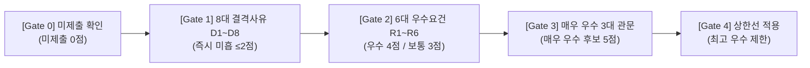

# 원광대학교 한의과대학 경혈학 학습일지 작성 가이드 및 다면평가 시스템

> **경혈학 학습일지 온라인 가이드 웹서비스 및 자동화 다면평가 프레임워크 (v3.4)**  
> 학생 안내용 GitHub Pages 웹 포털 & AI 에이전트(Antigravity·Claude Code) 5대 관문(Gate) 평가 파이프라인

[](https://jaehyokim-sketch.github.io/Study-Log/)
[](references/rubric.md)
[](scripts/eval_engine.py)

---

## 🌐 온라인 작성 가이드 (GitHub Pages)

학생들은 아래 웹페이지에서 최신 평가기준과 클로드 베르나르 5단계 과학적 방법론이 반영된 공식 가이드를 실시간으로 열람할 수 있습니다:  
👉 **[경혈학 학습일지 작성 가이드 온라인 포털](https://jaehyokim-sketch.github.io/Study-Log/)**

---

## 📌 주요 특징 및 평가 체계 (v3.4)

### 1. 학생용 작성 가이드 핵심 원칙
- **4대 핵심 섹션 구조**:
  1. **수업 내용 요약 (30%)**: 동영상 강의를 자기 언어로 재구성, 경맥 유주·병후·혈위 해부 및 안전심도 정리 (**상용경혈 필수·우선순위 80% 이상 학습 충실도 달성 필수**)
  2. **자가 학습/탐구 학습 (40%)**: **클로드 베르나르의 5단계 과학적 방법론**(질문·조작·측정·결과·해석) 적용 (**가설연역적 실증 논문 선정 시 '매우 우수' 자격**)
  3. **요약 및 토론 (30%)**: 수업-탐구 유기적 통합 고찰, 독자적 가설 수립 (**생성형 AI 미사용 학생 본인 직접 작성 선언 필수**)
  4. **출처 및 참고문헌·AI 활용 표기 (필수)**: 4대 표준 서지 양식 준수 및 AI 5대 지표(도구, 목적, 프롬프트, 수정내역, 위치) 투명 공개
- **형성평가 및 편집 규격 피드백 원칙**:
  - 참고문헌 4종 양식 준수 여부만 등급에 반영하며, 기타 파일명·크기·줄간격·이미지출처 등 형식 미흡은 **등급 강등 없이 학생 피드백에 보완 권고사항으로 기술**
- **3.3 교수자에게 드리는 학술 질문 (Question to Professor)**:
  - 표준 템플릿의 3.3 섹션 질문을 정밀 추출하여 교수자 맞춤형 학술 답변(200단어 내외) 1:1 매핑 제공

### 2. 교수자/조교용 자동화 평가 시스템 (5단계 Gate 순차 판정)

- **[Gate 0] 미제출 확인**: 기한 내 미제출 과제 분류 (0점)
- **[Gate 1] 8대 결격 사유 (D1~D8)**: 출처 누락(D1), **D2 허위 출처(Crossref/PubMed API 자동 교차 검증)**, 무단 표절(D3), AI 미기재(D4), AI 거짓표시(D5), 타인자료 AI 변형(D6), 의료 오정보(D7), 기준 미달(D8)
- **[Gate 2] 6대 우수 요건 (R1~R6)**: R1(구조), R2(수업요약 & 상용경혈 80%↑), R3(5단계 탐구 & 4/5 완화 수용), R4(토론 및 성찰), R5(참고문헌 4종 양식 준수), R6(AI 투명성)
- **[Gate 3] 매우 우수 후보 판정 (3대 필수 관문 통과)**:
  1. 「요약 및 토론」 AI 미사용 본인 직접 작성 표기 및 독자적 고찰 입증
  2. 가설연역적(Hypothetico-deductive) 실증 논문(실험/임상 연구) 선정 및 5단계 완결(5/5)
  3. 필수·우선순위 상용경혈 학습 충실도 90% 이상 달성
- **[Gate 4] 상한선 적용**: 타인일지 참고, 비실증 문헌연구 선정, 토론 미선언 시 최고 '우수'로 상한 제한

---

## 🗂️ 폴더 구조

```text
C:\workspace\학습일지 평가\ (Repository: Study-Log)
├── index.html                # 학생 안내용 온라인 가이드 웹페이지 (GitHub Pages)
├── 학습일지_평가지침.md        # 공식 평가지침 및 5대 Gate 루브릭 전문 (정본)
├── README.md                 # 본 프로젝트 개요 및 운영 가이드
├── 설치_및_설정_안내.md         # 상세 설치, 환경설정 및 트러블슈팅 매뉴얼
├── install.ps1               # 원클릭 AI 스킬 자동 배포 PowerShell 스크립트
├── deploy_to_gdrive.py       # Google Drive 실시간 동기화 배포 스크립트
│
├── references\
│   ├── rubric.md             # 공식 평가 루브릭 (5대 Gate 관문 체계 정본)
│   ├── 학습일지_표준_작성_템플릿.md  # 학생용 표준 작성 템플릿 마크다운
│   ├── 학습일지_표준_작성_템플릿.docx# 학생용 표준 작성 템플릿 Word 서식
│   ├── citation_cache.json   # Crossref/PubMed API 검증 로컬 캐시
│   └── 경혈학_상용경혈_필수_우선순위_표기본.xlsx # 14경맥 상용경혈 마스터 DB
│
└── scripts\
    ├── citation_verifier.py  # D2 허위 출처 검증 모듈 (Crossref/PubMed REST API)
    ├── eval_engine.py        # 48명 전수 5대 Gate 정밀 평가 및 엑셀 3시트 리포트 자동 생성기
    ├── generate_template_docs.py # 표준 템플릿 DOCX 자동 빌더
    ├── rename_logs.py        # 파일명 일괄 표준화 (회차_이름_학번_경맥명.pdf)
    └── run_07_eval.py        # 후속 차수 일괄 실행 러너
```

---

## 🚀 빠른 시작 (Quick Start)

### 1. 스킬 자동 설치 (Antigravity & Claude Code)
```powershell
cd "C:\workspace\학습일지 평가"
.\install.ps1
```

### 2. CLI 명령어 사용법
```bash
# 1. 파일명 일괄 정리
python scripts/rename_logs.py "대상폴더" --round 6 --meridian "독맥"

# 2. D2 허위 출처 단독 검증
python scripts/citation_verifier.py --doi "10.xxxx/xxxx" --title "논문명"

# 3. 전수 정밀 평가 및 엑셀 3시트 리포트 생성
python scripts/eval_engine.py --target "대상폴더" --prev4 "4차결과.xlsx" --prev5 "5차결과.xlsx" --round 6 --meridian "독맥" --output "최종피드백.xlsx"
```

---

## 💬 대화형 AI 어시스턴트 호출

대화창에서 아래 키워드로 평가 스킬을 활성화할 수 있습니다:
- `[학습일지평가]` / `[학습일지 평가]`
- `@학습일지평가` / `/study-log-eval`

---

**작성 및 관리:** 원광대학교 한의과대학 경혈학교실  
**최종 갱신:** 2026-11-17 (Version 3.4 개정 루브릭 및 5대 Gate 관문 체계 반영)
